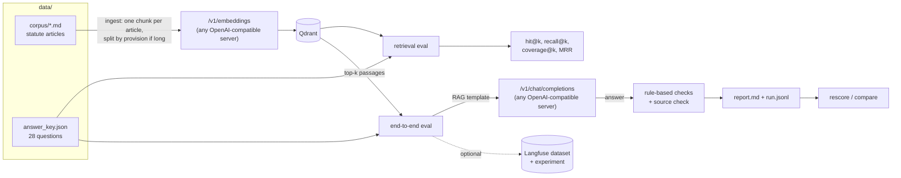

# legal-rag-eval

An evaluation harness for retrieval-augmented question answering over Brazilian law. It measures retrieval on its
own (does the right article come back, and does the context hold every fact the answer needs?) and then end to end,
against an answer key of rule-based checks: yes/no, forbidden terms, exact numbers and a required legal basis.

It is the evaluation method of a private on-premise legal RAG pilot, rebuilt on public statutes so it can be run and
inspected. The pilot's documents and answer key are not in this repository (see
[What is not included](#what-is-not-included-and-why)).

Versão em português: [README.pt.md](README.pt.md).

## Why measure retrieval and generation separately

A RAG answer can be wrong for two unrelated reasons. Either the passage with the answer was never retrieved, and no
prompt change will fix it. Or it was retrieved and the model still got it wrong, and no retrieval tuning will fix
that. A single end-to-end score cannot tell these apart, so you can spend a week on the wrong half.

This harness runs two evaluations:

1. **Retrieval only** (`legal-rag-eval retrieval`): no language model, seconds for the whole key. For each question,
   is an expected article among the top k chunks (hit@k, recall@k, MRR), and does the context contain every expected
   term (coverage@k)? Coverage is an upper bound for end-to-end accuracy: what is not in the context, the model can
   only get right from memory.
2. **End to end** (`legal-rag-eval e2e`): retrieve, fill the RAG template, generate, grade. Every miss is attributed:
   *retrieval* if no expected article was in the context, *generation* if it was and the answer is still wrong.

In the pilot, retrieval alone already returned the right passage for 74 of 76 questions, which meant the remaining
work was on the model side. The numbers are in [Results from the private pilot](#results-from-the-private-pilot).

## How it works



The system under test is either the small reference RAG in `rag.py` (Qdrant + template + any chat model), or, with
`--blackbox`, any existing RAG service that exposes `/v1/chat/completions`. In black-box mode only the answer is
graded; the source check and the retrieval/generation attribution need the passages.

## The answer key

One JSON list in `data/answer_key.json`. Each item:

```json
{
  "id": "cpc-03",
  "question": "Um município é réu numa ação cível. Ele tem mais tempo que um particular para se manifestar no processo?",
  "starts_with": "sim",
  "expected": ["dobro"],
  "forbidden": ["quádruplo"],
  "legal_basis": ["CPC art. 183"],
  "note": "The 1973 CPC gave public entities quadruple time to answer a claim. A model answering from memory may still say so."
}
```

`expected` entries must all appear; `a|b` means either. `legal_basis` lists article ids from the corpus: they are the
retrieval target and the citation the answer must contain. The pilot uses the same rules with Portuguese field names
(`pergunta`, `esperado`, `inicio`, `nao_pode`, `fonte`); the loader accepts those too.

### Check types

| Check | Rule | Example item | Passes | Fails |
|---|---|---|---|---|
| Exact number | Terms that start or end with a digit match whole numbers only | `cpc-01`, `"expected": ["15\|quinze"]` | "no prazo de 15 (quinze) dias" | "art. 1.015", "150 dias", "15,5" |
| Expected term | Case-insensitive substring; every entry required | `cdc-06`, `["verossímil\|verossimilhança", "hipossuficien"]` | "for verossímil a alegação ou ... hipossuficiente" | an answer that names only one of the two conditions |
| Yes/no | The word must be among the first six, and the answer must not start with the opposite word | `cpc-02`, `"starts_with": "não"` | "Não. Contam-se só os dias úteis." | "Sim, são dias corridos."; "Sim, ... não ..." |
| Forbidden term | Any match fails the answer | `clt-04`, `"forbidden": ["primeiro dia útil\|1º dia útil"]` | "até dez dias contados do término do contrato" | "até o primeiro dia útil" (the rule before the 2017 reform) |
| Legal basis | The answer cites one of the expected articles; "art. 1.009" equals "artigo 1009", "476-A" equals "476A" | `cpc-03`, `"legal_basis": ["CPC art. 183"]` | "... em dobro (art. 183 do CPC)" | "... em dobro, conforme o CPC" |
| Source check | Every article, súmula or statute the answer cites must be in a retrieved passage. Reported, not part of pass/fail | any | citations all found in the context | "art. 188" cited but not retrieved |

Several forbidden terms target rules from repealed law that a model may remember instead of reading the context:
quadruple time for public entities (CPC/1973), a 20-year limitation period and majority at 21 (Civil Code of 1916),
and the old deadline for severance pay (CLT before 2017).

Why plain rules and not a model as judge: they are deterministic and free, so every run is graded the same way and
two runs can be compared question by question. A judge model is another model to evaluate. The cost is that rules can
be fooled, in both directions:

- A keyword match passes wrong answers. A small model often repeats the question back, so a term from the question
  shows up in a wrong answer. That is why yes/no items check the start of the answer and why `cc-05` has no expected
  terms at all, only the yes/no word and the citation.
- A forbidden term can catch a correct answer that mentions the old rule to reject it ("não é mais em quádruplo").

So the key needs maintenance: read the answers that passed now and then, tighten the rules when you find a false pass,
and re-score old runs with the new key (`legal-rag-eval rescore`) so the comparison between runs stays fair. That is
how the pilot's stricter key came about.

## Running it

Requirements: Python 3.12+, an OpenAI-compatible embeddings endpoint, an OpenAI-compatible chat endpoint, and
Qdrant (Docker, or the embedded mode of qdrant-client with no server).

```bash
git clone https://github.com/jmilheiro73/legal-rag-eval && cd legal-rag-eval
python3 -m venv .venv && . .venv/bin/activate
pip install -r requirements.txt && pip install --no-deps -e .

cp .env.example .env        # set the endpoints and models, then load it:
set -a; . ./.env; set +a

docker compose up -d        # Qdrant on localhost:6333 (or set QDRANT_PATH=.qdrant to skip Docker)

legal-rag-eval validate     # answer key against corpus, offline
legal-rag-eval ingest       # chunk, embed, index
legal-rag-eval retrieval --k 1,3,5
legal-rag-eval e2e          # needs LLM_MODEL
```

Any server that speaks the OpenAI format works. Set the base URL (ending in `/v1`), the model name and, for hosted
APIs, the key:

| Server | Chat: `LLM_BASE_URL` | Embeddings: `EMBED_BASE_URL` |
|---|---|---|
| llama.cpp `llama-server` | `http://localhost:8080/v1` | a second `llama-server` in embedding mode with a bge-m3 GGUF |
| Ollama | `http://localhost:11434/v1` | the same; `ollama pull bge-m3` |
| vLLM | `http://localhost:8000/v1` | a vLLM instance serving an embedding model |
| Hosted API | the provider's OpenAI-compatible URL, with `LLM_API_KEY` | the same, with `EMBED_API_KEY` |

The collection records which embedding model built it, and the retrieval and end-to-end commands refuse to run with a
different one. Temperature defaults to 0, so that a change in the score comes from the change being tested.

Outputs go to `results/`:

- `retrieval-<embed model>-<time>.md` and `.json`: summary table per k and the misses, with what was retrieved instead.
- `e2e-<model>-<pipeline>-<time>.md`: pass rate, failed checks by type, misses by cause, results by law, then every
  question with its failed checks, the articles retrieved, unsupported citations and the full answer.
- `e2e-<...>.jsonl`: one line per question with the answer and the rules it was graded with, for `rescore` and
  `compare`. Endpoint URLs are not written to results files.

### Comparing changes

```bash
legal-rag-eval e2e --template no-basis       # baseline template
legal-rag-eval e2e --template basis          # the default: requires the legal basis
legal-rag-eval compare results/e2e-A.jsonl results/e2e-B.jsonl
legal-rag-eval rescore results/e2e-*.jsonl   # after editing the answer key
```

`compare` lists the questions that went from fail to pass and from pass to fail. "The total went up and no question
got worse" is a stronger result than a higher total. `--only cpc-01,cpc-02` runs a subset and keeps the key's ids.

To evaluate an existing RAG service instead of the reference pipeline:

```bash
legal-rag-eval e2e --blackbox --llm-url http://localhost:8000/v1 --llm-model my-rag
```

### Langfuse (optional)

Install the extra (`pip install langfuse==5.1.0`) and set `LANGFUSE_HOST`, `LANGFUSE_PUBLIC_KEY` and
`LANGFUSE_SECRET_KEY`. The answer key becomes a dataset with stable item ids (re-running updates instead of
duplicating), and each `e2e` run becomes a dataset experiment with the scores `passed`, `seconds` and
`unsupported_citations` per item. Every request carries a W3C `traceparent` header, so a black-box backend that is
itself traced in Langfuse shows its trace inside the experiment item. Without these variables nothing is sent; a
self-hosted Langfuse works the same way.

## Results from the private pilot

These numbers come from the private pilot this method was built for: an on-premise assistant for a law firm, with a
FastAPI + LangGraph backend, Qdrant with bge-m3 embeddings, an 8B open-weights model on llama.cpp, Open WebUI as the
interface and a self-hosted Langfuse. They were measured on the firm's own material with a 76-question answer key that
is re-run after every change. Neither the material nor the key is in this repository, so these numbers cannot be
reproduced from it.

| Measurement | Result |
|---|---|
| Retrieval alone: the right passage comes back | 74 of 76 questions |
| End to end, after requiring the legal basis in the RAG template | 61 → 70 of 76, no question got worse |
| End to end, with the stricter answer key | 65 of 76 |
| Misses caused by the model rather than retrieval | 10 of 11 |

Each run was saved as a Langfuse dataset experiment. With retrieval at 74/76, the lever is the model, not the search.

No results on the public set are committed yet. They depend on the models you point the harness at; run it and
the report lands in `results/`.

## The public dataset

28 questions over 29 statute articles, all from public Brazilian law. Statutes are not protected by copyright in
Brazil (Lei 9.610/1998, art. 8º, IV).

| Code | Statute | Articles in the corpus |
|---|---|---|
| CDC | [Lei 8.078/1990](https://www.planalto.gov.br/ccivil_03/leis/l8078compilado.htm) | 6º (caput, VIII), 14 (caput, § 3º), 18 (caput, § 1º), 26, 27, 49 |
| LGPD | [Lei 13.709/2018](https://www.planalto.gov.br/ccivil_03/_ato2015-2018/2018/lei/l13709compilado.htm) | 7º (caput, I to X), 41 (caput, § 2º), 48 (caput), 52 (caput, I, II) |
| CPC | [Lei 13.105/2015](https://www.planalto.gov.br/ccivil_03/_ato2015-2018/2015/lei/l13105.htm) | 183 (caput), 219, 319 (caput, I to VII), 335 (caput), 523 (caput, § 1º), 525 (caput) |
| CLT | [Decreto-Lei 5.452/1943](https://www.planalto.gov.br/ccivil_03/decreto-lei/del5452compilado.htm) | 58 (caput), 59 (caput, §§ 2º, 5º, 6º), 71 (caput, §§ 1º, 4º), 476-A (caput), 477 (caput, §§ 6º, 8º) |
| CF | [Constituição de 1988](https://www.planalto.gov.br/ccivil_03/constituicao/constituicaocompilado.htm) | 7º (caput, XVI, XVII, XXI, XXIX) |
| Lei 12.506 | [Lei 12.506/2011](https://www.planalto.gov.br/ccivil_03/_ato2011-2014/2011/lei/l12506.htm) | 1º |
| CC | [Lei 10.406/2002](https://www.planalto.gov.br/ccivil_03/leis/2002/l10406compilada.htm) | 5º (caput), 186, 205, 206 (§ 3º, V), 445 (caput), 927 |

Provenance and format:

- The text is the current wording from the consolidated versions on planalto.gov.br, retrieved on 2026-11-04. It was
  transcribed through a web-fetching tool, whose output had broken character encoding; accents were restored by hand,
  ordinal markers and spacing were normalised (`§ 2o` → `§ 2º`), and amendment notes and struck-through text were left
  out. Provisions not included are marked `[...]`. Check against the source before relying on any of it: this is test
  data for an evaluation, not a legal reference.
- Some articles are there as distractors: CLT art. 58 and LGPD art. 41 are not the answer to any question, and several
  answers share numbers with a neighbouring article (30 days in CDC arts. 18 and 26, 50% in CLT art. 71 and CF art. 7º).
- `legal-rag-eval validate` (also run in CI) checks that every question can be answered from its expected articles:
  each expected term is in the article text and no forbidden term is.
- The questions were written for this repository from the statute text. Some cover the same public-law topics as
  questions in the pilot's key (common deadlines, for instance); none uses the pilot's material.
- An answer key ages with the law. Art. 7º, XIII of the Constitution (weekly working hours) was amended in October
  2026 with a phased transition (EC 141/2026, according to the consolidated text), so no question asks about it.

## What is not included, and why

- **The firm's material and the pilot's 76-question key.** Internal guidance, doctrine and client documents are
  confidential, masked or not, and the pilot's questions refer to them. That is why the numbers above cannot be
  reproduced here, and why this repository uses a separate public dataset.
- **The production system.** The pilot's backend, its prompts per area of law, the interface and the infrastructure
  are tied to the firm and are not needed to show the method. `rag.py` is a minimal reference RAG, there so the
  harness has something to evaluate.
- **A model as judge.** Deliberately left out; see [Check types](#check-types).
- **Retrieval variants** (hybrid search, reranking, metadata filters). Out of scope: the harness evaluates whatever
  retrieval you plug in through the `Retriever` protocol.
- **Legal advice.** The corpus is a small excerpt and can go out of date.

## Development

```bash
pip install -r requirements-dev.txt && pip install --no-deps -e .
ruff check . && ruff format --check . && mypy && pytest
```

The tests need no model, network or Qdrant server: embeddings are a deterministic word hash, chat answers are
scripted, Qdrant runs in memory or in embedded mode on disk, and the CLI test starts a local fake OpenAI-compatible
server. CI (`.github/workflows/tests.yml`) runs lint, type checks, `validate` and the tests on Python 3.12 and 3.13.

```
data/corpus/*.md          statute excerpts, one file per statute
data/answer_key.json      28 questions
src/legal_rag_eval/
  checks.py               rule-based checks and grading
  citations.py            citation extractor and source check
  answer_key.py           schema and loader (also reads the pilot's Portuguese field names)
  corpus.py               corpus parser and statute chunking
  clients.py              OpenAI-compatible embeddings and chat clients
  store.py                Qdrant collection
  rag.py                  reference RAG and black-box pipelines, templates in prompts/
  retrieval_eval.py       hit@k, recall@k, coverage@k, MRR
  e2e_eval.py             end-to-end run, miss attribution, run files
  report.py               Markdown report
  rescore.py              re-score and compare runs
  tracing.py              optional Langfuse datasets and experiments
  validate.py             answer key against corpus
  cli.py                  command line
tests/
```

## License

MIT, see [LICENSE](LICENSE). The statute text in `data/corpus/` is public law and not subject to copyright.
