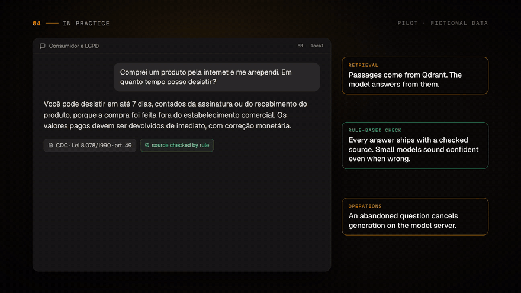

# legal-rag-eval

Avaliação de RAG (geração com busca) sobre a legislação brasileira. Mede a busca sozinha (o artigo certo volta? o
contexto tem todos os fatos de que a resposta precisa?) e depois a resposta inteira, contra um gabarito de regras:
sim/não, termos proibidos, números exatos e fundamento legal obrigatório.

É o método de avaliação de um piloto privado de RAG jurídico local, refeito sobre leis públicas para poder ser
executado e inspecionado. Os documentos e o gabarito do piloto não estão neste repositório (ver
[O que não está incluído](#o-que-não-está-incluído-e-por-quê)).

[](https://github.com/jmilheiro73/legal-rag-eval/releases/download/videos/rag-pt.mp4)

<sub>O piloto privado de onde vem este método. ▶ Vídeo narrado: <a href="https://github.com/jmilheiro73/legal-rag-eval/releases/download/videos/rag-pt.mp4">Português</a> · <a href="https://github.com/jmilheiro73/legal-rag-eval/releases/download/videos/rag-en.mp4">English</a></sub>

English version: [README.md](README.md).

## Por que medir busca e geração separadamente

Uma resposta de RAG pode estar errada por dois motivos sem relação entre si. Ou o trecho com a resposta nunca foi
buscado, e nenhuma mudança de prompt resolve. Ou foi buscado e o modelo errou mesmo assim, e nenhum ajuste de busca
resolve. Um placar único não separa os dois casos, e dá para gastar uma semana na metade errada.

Por isso são duas avaliações:

1. **Só a busca** (`legal-rag-eval retrieval`): sem modelo de linguagem, segundos para o gabarito inteiro. Para cada
   pergunta, algum artigo esperado está entre os k primeiros trechos (hit@k, recall@k, MRR)? O contexto contém todos
   os termos esperados (coverage@k)? A cobertura é um teto para o acerto: o que não está no contexto o modelo só acerta
   de memória.
2. **Ponta a ponta** (`legal-rag-eval e2e`): busca, preenche o template do RAG, gera e pontua. Cada erro é atribuído:
   *busca* se nenhum artigo esperado estava no contexto, *geração* se estava e a resposta saiu errada.

No piloto, a busca sozinha já trazia o trecho certo em 74 de 76 perguntas: o trabalho que faltava era do lado do
modelo. Os números estão em [Resultados do piloto privado](#resultados-do-piloto-privado).

## Como funciona

O diagrama está no [README em inglês](README.md#how-it-works). Em resumo: os artigos de `data/corpus/` viram um
trecho por artigo (dividido por dispositivo quando é longo), com embeddings de qualquer servidor compatível com a API
da OpenAI, num Qdrant. A avaliação da busca consulta o Qdrant; a de ponta a ponta monta o prompt com os trechos,
chama `/v1/chat/completions`, aplica as regras e a conferência de fontes, e grava `report.md` e `run.jsonl`, que
depois podem ser repontuados ou comparados. O Langfuse é opcional.

O sistema avaliado é o RAG de referência em `rag.py` (Qdrant + template + qualquer modelo de chat) ou, com
`--blackbox`, qualquer serviço de RAG que exponha `/v1/chat/completions`. No modo caixa-preta só a resposta é
pontuada; a conferência de fontes e a atribuição busca/geração precisam dos trechos.

## O gabarito

Uma lista JSON em `data/answer_key.json`. Cada item:

```json
{
  "id": "cpc-03",
  "question": "Um município é réu numa ação cível. Ele tem mais tempo que um particular para se manifestar no processo?",
  "starts_with": "sim",
  "expected": ["dobro"],
  "forbidden": ["quádruplo"],
  "legal_basis": ["CPC art. 183"]
}
```

Todos os termos de `expected` precisam aparecer; `a|b` aceita qualquer um. `legal_basis` lista ids de artigos do
corpus: são o alvo da busca e a citação que a resposta precisa ter. O piloto usa as mesmas regras com campos em
português (`pergunta`, `esperado`, `inicio`, `nao_pode`, `fonte`), que o carregador também aceita.

### Tipos de regra

| Regra | Como funciona | Item | Passa | Não passa |
|---|---|---|---|---|
| Número exato | Termo que começa ou termina em dígito casa só como número inteiro | `cpc-01`, `["15\|quinze"]` | "no prazo de 15 (quinze) dias" | "art. 1.015", "150 dias", "15,5" |
| Termo esperado | Sem distinguir maiúsculas; todos obrigatórios | `cdc-06`, `["verossímil\|verossimilhança", "hipossuficien"]` | "for verossímil a alegação ou ... hipossuficiente" | resposta que cita só uma das duas condições |
| Sim/não | A palavra tem de estar entre as seis primeiras, e a resposta não pode começar pela oposta | `cpc-02`, `"starts_with": "não"` | "Não. Contam-se só os dias úteis." | "Sim, são dias corridos."; "Sim, ... não ..." |
| Termo proibido | Qualquer ocorrência reprova | `clt-04`, `["primeiro dia útil\|1º dia útil"]` | "até dez dias contados do término do contrato" | "até o primeiro dia útil" (regra anterior à reforma de 2017) |
| Fundamento legal | A resposta cita um dos artigos esperados; "art. 1.009" = "artigo 1009", "476-A" = "476A" | `cpc-03`, `["CPC art. 183"]` | "... em dobro (art. 183 do CPC)" | "... em dobro, conforme o CPC" |
| Conferência de fontes | Todo artigo, súmula ou lei citado tem de estar num trecho buscado. Vai no relatório, não reprova | qualquer | citações todas no contexto | "art. 188" citado sem ter sido buscado |

Vários termos proibidos pegam regras de lei revogada que o modelo pode lembrar em vez de ler no contexto: prazo em
quádruplo da Fazenda (CPC/1973), prescrição de 20 anos e maioridade aos 21 (Código Civil de 1916) e o prazo antigo das
verbas rescisórias (CLT antes de 2017).

Por que regras e não um modelo como juiz: são determinísticas e de graça, então toda rodada é pontuada do mesmo jeito
e duas rodadas podem ser comparadas pergunta a pergunta. Um modelo juiz é mais um modelo a avaliar. O custo é que as
regras erram nos dois sentidos:

- Termo solto aprova resposta errada. Modelo pequeno costuma repetir a pergunta, e um termo da pergunta aparece numa
  resposta errada. Por isso as perguntas de sim/não conferem o começo da resposta, e o `cc-05` não tem termo esperado,
  só o sim/não e a citação.
- Termo proibido pode reprovar resposta certa que menciona a regra antiga para descartá-la ("não é mais em quádruplo").

O gabarito precisa de manutenção: ler de vez em quando as respostas aprovadas, apertar a regra quando achar um acerto
falso e repontuar as rodadas antigas com o gabarito novo (`legal-rag-eval rescore`) para a comparação continuar justa.
Foi assim que surgiu o gabarito mais rígido do piloto.

## Como rodar

Precisa de Python 3.12+, um endpoint de embeddings e um de chat compatíveis com a API da OpenAI, e o Qdrant (Docker,
ou o modo embutido do qdrant-client, sem servidor).

```bash
git clone https://github.com/jmilheiro73/legal-rag-eval && cd legal-rag-eval
python3 -m venv .venv && . .venv/bin/activate
pip install -r requirements.txt && pip install --no-deps -e .

cp .env.example .env        # endpoints e modelos; depois carregar:
set -a; . ./.env; set +a

docker compose up -d        # Qdrant em localhost:6333 (ou QDRANT_PATH=.qdrant, sem Docker)

legal-rag-eval validate     # gabarito contra o corpus, sem rede
legal-rag-eval ingest       # divide, gera embeddings, indexa
legal-rag-eval retrieval --k 1,3,5
legal-rag-eval e2e          # precisa de LLM_MODEL
```

Qualquer servidor no formato da OpenAI serve: llama.cpp (`llama-server`, por padrão em `http://localhost:8080/v1`),
Ollama (`http://localhost:11434/v1`, `ollama pull bge-m3` para os embeddings), vLLM ou uma API hospedada, com
`LLM_API_KEY` e `EMBED_API_KEY`. A coleção guarda o modelo de embedding com que foi criada, e a avaliação se recusa a
rodar com outro. A temperatura padrão é 0, para que a mudança no placar venha da mudança testada.

Os resultados vão para `results/`: o relatório de busca (`retrieval-*.md` e `.json`), o relatório de ponta a ponta
(`e2e-*.md`: acerto, regras que falharam por tipo, erros por causa, resultado por lei e cada pergunta com a resposta
inteira) e as respostas (`e2e-*.jsonl`), usadas por `rescore` e `compare`. As URLs dos endpoints não são gravadas.

### Comparar mudanças

```bash
legal-rag-eval e2e --template no-basis       # template de base
legal-rag-eval e2e --template basis          # o padrão: exige o fundamento legal
legal-rag-eval compare results/e2e-A.jsonl results/e2e-B.jsonl
legal-rag-eval rescore results/e2e-*.jsonl   # depois de mexer no gabarito
```

`compare` lista as perguntas que passaram de erro para acerto e de acerto para erro. "O total subiu e nenhuma pergunta
piorou" vale mais do que um total maior. Para avaliar um serviço de RAG que já existe:
`legal-rag-eval e2e --blackbox --llm-url http://localhost:8000/v1 --llm-model meu-rag`.

### Langfuse (opcional)

Com `pip install langfuse==5.1.0` e `LANGFUSE_HOST`, `LANGFUSE_PUBLIC_KEY` e `LANGFUSE_SECRET_KEY` no ambiente, o
gabarito vira um dataset (ids fixos: rodar de novo atualiza em vez de duplicar) e cada rodada `e2e` vira um
experimento com os scores `passed`, `seconds` e `unsupported_citations` por item. Cada requisição leva o cabeçalho
`traceparent`, então um backend caixa-preta que também manda traces ao Langfuse aparece dentro do item do
experimento. Sem essas variáveis nada é enviado.

## Resultados do piloto privado

Estes números são do piloto privado para o qual o método foi feito: um assistente local para um escritório de
advocacia, com backend em FastAPI + LangGraph, Qdrant com embeddings bge-m3, um modelo aberto de 8B no llama.cpp, Open
WebUI como interface e Langfuse auto-hospedado. Foram medidos sobre o material do próprio escritório, com um gabarito
de 76 perguntas reexecutado a cada mudança. Nem o material nem o gabarito estão aqui, então estes números não podem
ser reproduzidos a partir deste repositório.

| Medição | Resultado |
|---|---|
| Só a busca: o trecho certo volta | 74 de 76 perguntas |
| Ponta a ponta, depois de exigir o fundamento no template do RAG | 61 → 70 de 76, nenhuma pergunta piorou |
| Ponta a ponta, com o gabarito mais rígido | 65 de 76 |
| Erros do modelo, e não da busca | 10 de 11 |

Cada rodada ficou salva como experimento de dataset no Langfuse. Com a busca em 74/76, a alavanca é o modelo, não a
busca.

Ainda não há resultados do conjunto público neste repositório: dependem dos modelos usados. Rodando, o relatório vai
para `results/`.

## O conjunto público

28 perguntas sobre 29 artigos, todos de lei federal brasileira. Lei não tem proteção de direito autoral no Brasil
(Lei 9.610/1998, art. 8º, IV). A lista de leis e artigos, com os links, está no
[README em inglês](README.md#the-public-dataset).

- O texto é a redação atual das versões compiladas do planalto.gov.br, consultadas em 04/11/2026, transcrita por uma
  ferramenta de leitura de páginas cuja saída veio com a codificação de caracteres quebrada: os acentos foram
  restaurados à mão, ordinais e espaços foram normalizados (`§ 2o` → `§ 2º`), e as notas de alteração e o texto
  revogado ficaram de fora. Dispositivos omitidos estão marcados com `[...]`. Confira com a fonte antes de usar: é
  dado de teste de uma avaliação, não referência jurídica.
- Alguns artigos estão lá para confundir a busca: o art. 58 da CLT e o art. 41 da LGPD não respondem a nenhuma
  pergunta, e várias respostas têm o mesmo número de um artigo vizinho (30 dias nos arts. 18 e 26 do CDC, 50% no
  art. 71 da CLT e no art. 7º da CF).
- `legal-rag-eval validate` (também no CI) confere que cada pergunta pode ser respondida pelos artigos esperados: todo
  termo esperado está no texto e nenhum termo proibido está.
- As perguntas foram escritas para este repositório a partir do texto da lei. Algumas tratam dos mesmos temas de lei
  pública que perguntas do gabarito do piloto (prazos comuns, por exemplo); nenhuma usa o material do piloto.
- Gabarito envelhece com a lei: quando uma lei muda, as perguntas afetadas precisam ser revistas antes da próxima
  rodada. Confira o corpus no planalto.gov.br antes de confiar nele.

## O que não está incluído, e por quê

- **O material do escritório e o gabarito de 76 perguntas do piloto.** Orientações internas, doutrina e documentos de
  clientes são confidenciais, mascarados ou não, e as perguntas do piloto se referem a eles. Por isso os números acima
  não podem ser reproduzidos aqui, e por isso este repositório usa um conjunto público à parte.
- **O sistema de produção.** O backend do piloto, os prompts por área, a interface e a infraestrutura são do
  escritório e não são necessários para mostrar o método. `rag.py` é um RAG mínimo de referência, só para haver o que
  avaliar.
- **Modelo como juiz.** Ficou de fora de propósito; ver [Tipos de regra](#tipos-de-regra).
- **Variações de busca** (híbrida, reranking, filtros por metadado). Fora do escopo: a avaliação mede a busca que for
  ligada pelo protocolo `Retriever`.
- **Orientação jurídica.** O corpus é um recorte pequeno e pode ficar desatualizado.

## Desenvolvimento

```bash
pip install -r requirements-dev.txt && pip install --no-deps -e .
ruff check . && ruff format --check . && mypy && pytest
```

Os testes não precisam de modelo, rede nem servidor Qdrant: os embeddings são um hash determinístico das palavras, as
respostas do chat são roteirizadas, o Qdrant roda em memória ou no modo embutido em disco, e o teste da linha de
comando sobe um servidor falso compatível com a OpenAI. O CI roda lint, tipos, `validate` e os testes em Python 3.12
e 3.13.

## Licença

MIT, ver [LICENSE](LICENSE). O texto legal em `data/corpus/` é lei e não tem proteção de direito autoral.
